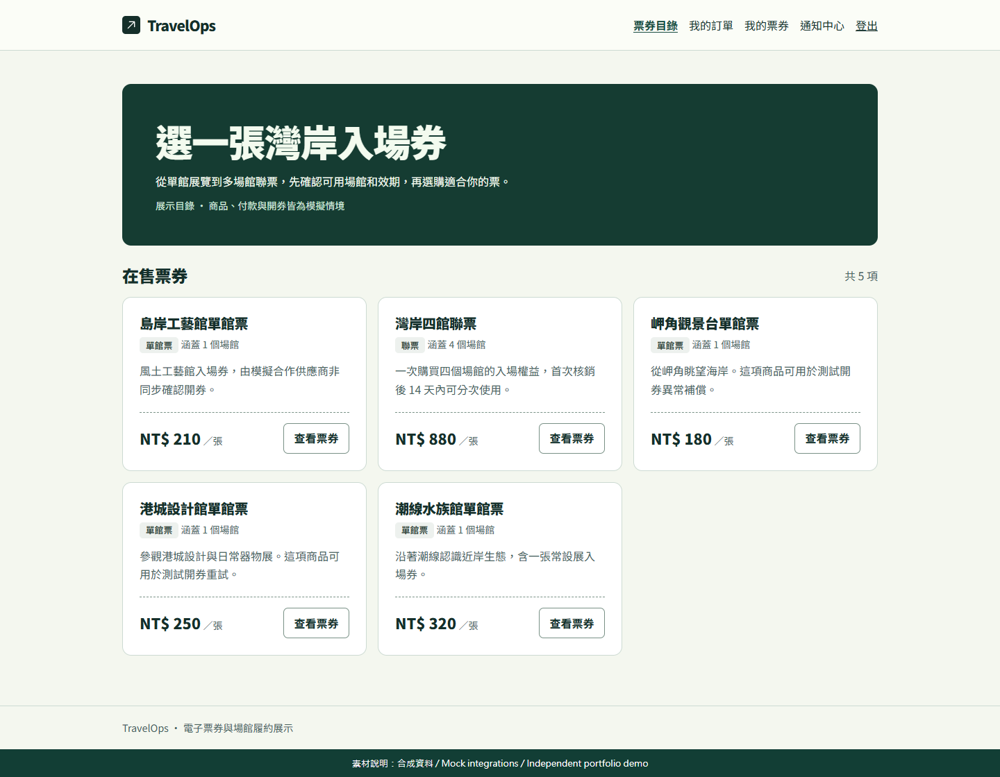
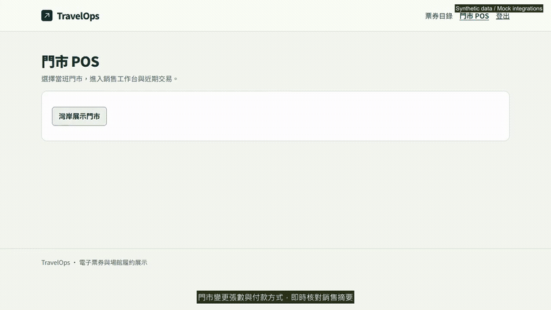
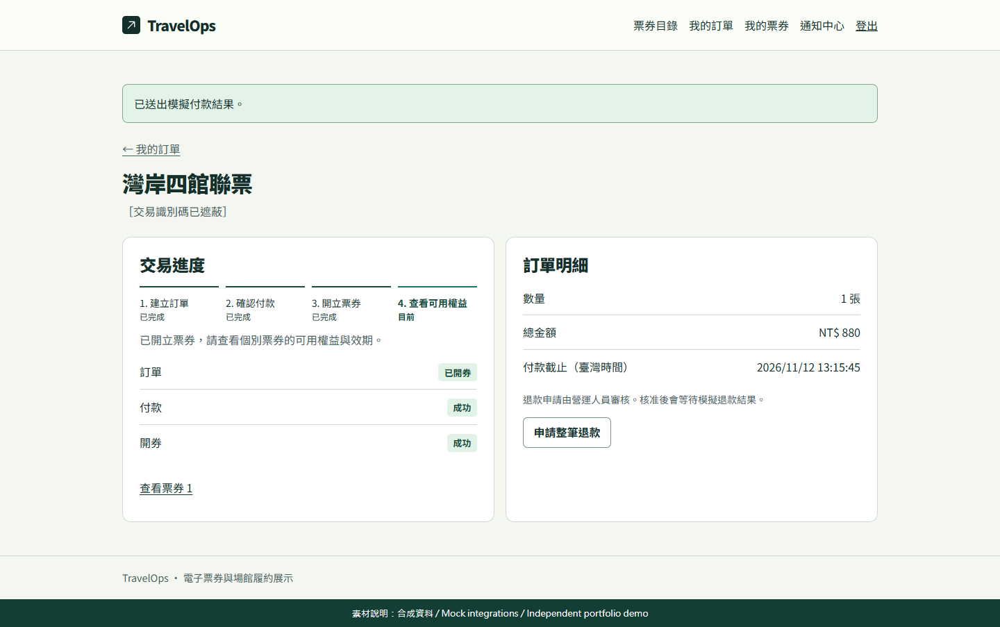
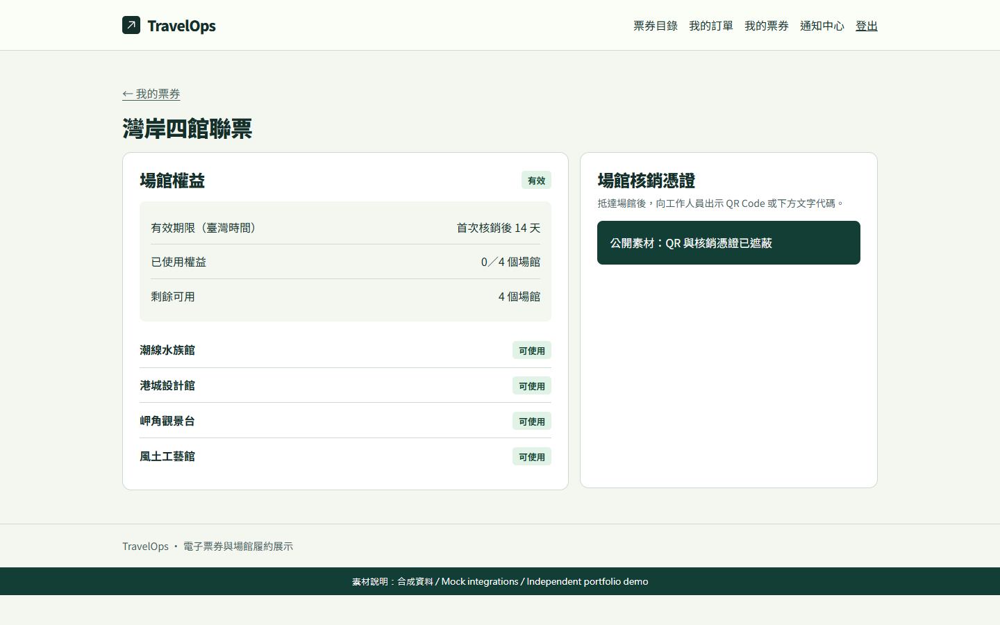
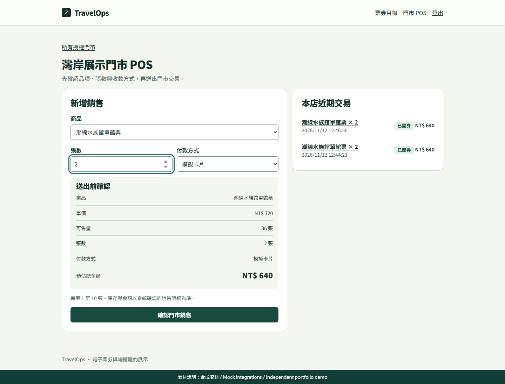
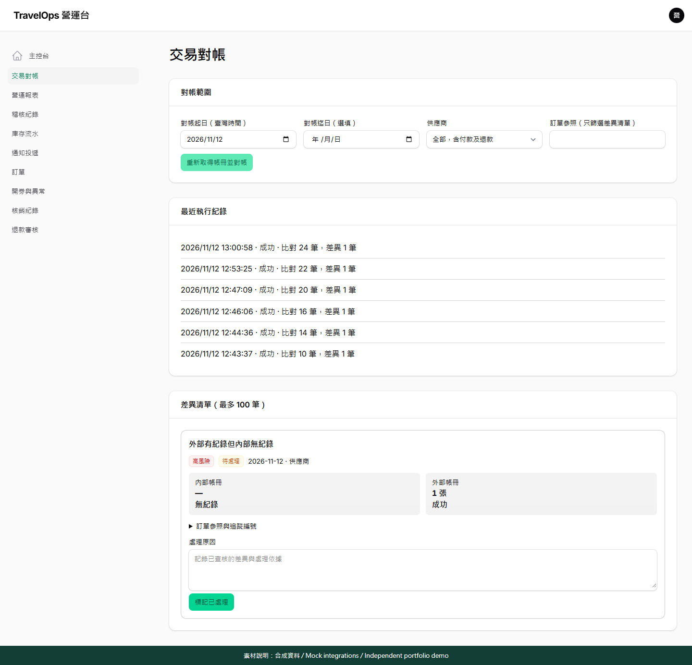
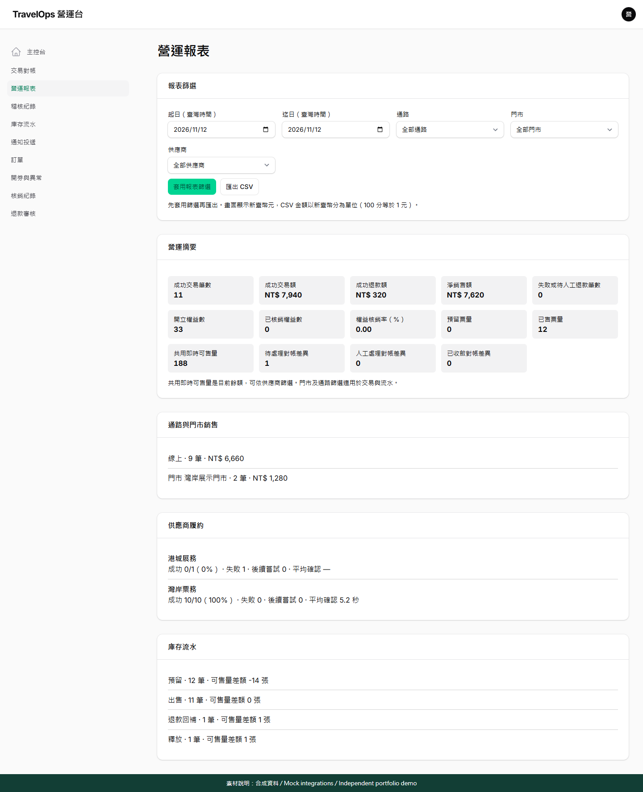
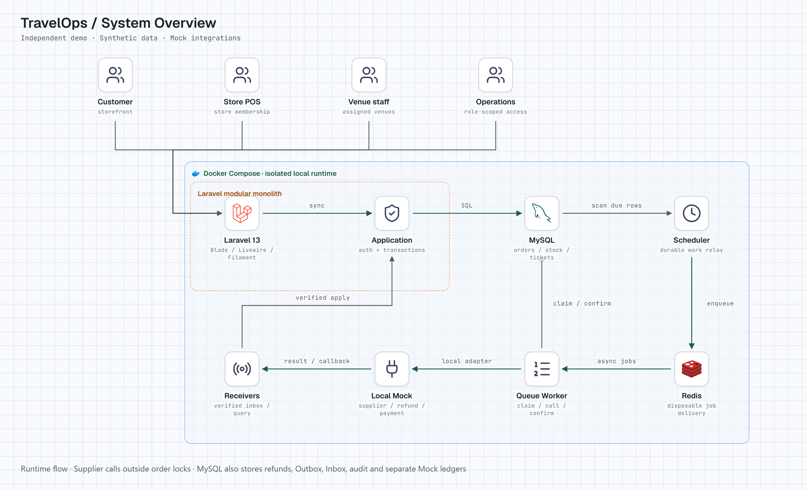

# TravelOps

Ticket fulfillment and operations connecting online checkout, store POS, venue redemption and reconciliation through shared stock and recoverable asynchronous work.

[繁體中文](README.md) · [Detailed English case study](docs/portfolio/travelops-v3/TRAVELOPS_PORTFOLIO_EN.md)



This runnable engineering showcase uses synthetic accounts, venues and transactions. Payment, suppliers, refunds and external notifications use local Mock adapters.

## Demo

[Watch or download the 74-second MP4, approximately 1 MB](docs/portfolio/travelops-v3/video/travelops-v3-demo.mp4). It follows customer checkout and duplicate payment callbacks, ticket entitlements, a POS sale, issuance exceptions, reconciliation and reporting. Traditional Chinese captions are burned in; [English SRT](docs/portfolio/travelops-v3/video/travelops-v3-demo.en.srt) is also available. Download the file if GitHub does not provide inline playback.

The 16-second GIF below shows the actual POS workflow: select a product, change quantity and payment method, confirm NT$640, then submit the sale. It is approximately 598 KiB and comes directly from the existing recording.



The reviewed footage was captured on 2026-11-12. Complete transaction identifiers and redemption credentials are redacted. See the [storyboard](docs/portfolio/travelops-v3/video/demo-storyboard.md) for timing and the explicitly marked waiting cut. No external video hosting or new public deployment was created.

## Problem and working features

Online and store sales compete for stock. Payment events can be replayed, suppliers can accept a request before losing its response, and refund approval can race with redemption. MySQL owns these state transitions; the scheduler and queue handle recoverable work, while operators can inspect unfinished transactions.

### Customer order progress

Payment, issuance and usable entitlements have separate states. The simulator exercises duplicate and out-of-order payment callbacks.



### Venue entitlements

Bundles track each venue separately. Validity starts at the first successful redemption; staff access is restricted to assigned venues, and unresolved approved refunds pause redemption. QR codes and redemption tokens are redacted.



### Store POS

The live summary shows product, quantity and payment method before submission. POS reuses online checkout pricing, stock reservation and idempotency rules. Supervisors can review a Taiwan-business-day closing summary.



### Refunds and reconciliation

Operators approve full-order refunds and compare internal transactions with separately persisted Mock ledgers. Human dispositions preserve reasons without rewriting transaction amounts.



### Operational reporting

Filters cover date, channel, store and supplier, with CSV export. The UI displays New Taiwan dollars; CSV uses integer cents. KPI values below are synthetic results.



Also available: [390 px product view](docs/portfolio/travelops-v3/screenshots/travelops-product-mobile.png), [mobile POS](docs/portfolio/travelops-v3/screenshots/travelops-pos-mobile.png) and the [eight-image manifest](docs/portfolio/travelops-v3/screenshots-manifest.md).

## Architecture



Blade, Livewire and Filament share a Laravel modular monolith and Application services. MySQL holds authoritative orders, inventory, tickets, Inbox, Outbox and audit records. The scheduler scans durable rows and enqueues Redis jobs. Workers claim leases, call local Mock adapters outside order locks, and confirm results in a new transaction. The database-to-scheduler arrow means polling, not a database push.

The existing diagram was checked against graphify structural extraction and the owning source files. See the [current source map and validation](docs/portfolio/travelops-v3/SHOWCASE_VALIDATION.md), [overview SVG](docs/portfolio/travelops-v3/architecture/travelops-system-overview.svg), [transaction flow SVG](docs/portfolio/travelops-v3/architecture/travelops-transaction-flow.svg) and [Mermaid source](docs/portfolio/travelops-v3/architecture/travelops-system-overview.mmd).

## Engineering highlights and decisions

| Concern | Implementation and trade-off | Evidence |
| --- | --- | --- |
| Shared stock | POS reuses `Checkout::place`; product and stock locks protect reservations and entitlement snapshots. Production throughput is unmeasured. | [Checkout](app/Application/Checkout.php), [concurrency tests](tests/Integration/MySqlConcurrencyTest.php) |
| Replayed callbacks | HMAC, payment references, amounts and currency are validated; event keys and body hashes distinguish replay from conflicting content. | [PaymentWebhook](app/Application/PaymentWebhook.php) |
| Lost work or responses | Payment and issuance Outbox commit atomically. Stable request keys, leases, polling and query-before-replay support recovery. Adapter calls run outside order locks. | [Issuance](app/Application/Issuance.php), [Redis Outbox tests](tests/Integration/RedisOutboxTest.php) |
| Refund/redemption races | Both acquire the order lock. Approved unresolved refunds pause redemption; confirmed settlement revokes entitlements and releases stock. Full-order refunds only. | [RefundOrder](app/Application/RefundOrder.php), [Redeem](app/Application/Redeem.php) |
| Investigable records | Transactions, Mock statements and human dispositions stay separate; reconciliation can be rerun without rewriting original amounts. | [Reconcile](app/Application/Reconcile.php), [reporting definitions](docs/architecture/REPORTING_DEFINITIONS.md) |

POS deliberately captures its local Mock payment inside the outer transaction; this is not a design for real network payment calls. Supplier and refund callbacks validate a timestamp window; payment callbacks do not share that check. Existing decisions and detail remain in [ADR 004](docs/decisions/004-v2-operation-reliability.md), the [system overview](docs/architecture/V2_SYSTEM_OVERVIEW.md) and [data model](docs/architecture/V2_DATA_MODEL.md).

## Testing and results

| Evidence | Verified result | Boundary |
| --- | --- | --- |
| [Baseline CI](https://github.com/Cizing24/TravelOps/actions/runs/44552435274) | 36 PHPUnit tests, 425 assertions; CI passed at `9bf8b97` on 2026-11-19. | Linux Compose, Pint, PHPStan, PHPUnit and Chrome journeys; remote status and logs checked during this refresh. |
| [2026-11-12 media validation](docs/portfolio/travelops-v3/MEDIA_VALIDATION_REPORT.md) | 34 tests, 416 assertions, zero failures. | Historical isolated MySQL/Redis execution; not this refresh's local run. |
| [V3 acceptance](docs/reports/V3_UX_DOCKER_VALIDATION.md) | Layout checks at 1280, 768 and 390 px. | Chrome; no claim of physical-device, screen-reader or full cross-browser coverage. |
| [Showcase validation](docs/portfolio/travelops-v3/SHOWCASE_VALIDATION.md) | Local links, PNG/SVG files, animated GIF frames, full MP4 decode and architecture/source checks. | Documentation and media verification; the business suite was not rerun locally for this refresh. |

No production load, commercial outcomes or performance improvement percentages are claimed. Use the PR Checks for the new commit's CI status.

## Stack

PHP 8.4, Laravel 13, Blade, Livewire 4, Filament 5, Tailwind CSS 4, MySQL 8.4/InnoDB, Redis 7.4 and Docker Compose. PHPUnit covers business rules and integration; Playwright covers browser journeys. Exact versions are in [composer.lock](composer.lock) and [package-lock.json](package-lock.json).

## Getting started

Install Docker Engine and Compose v2.24 or later. Windows can use Docker Desktop with Linux containers; the containers provide PHP, Composer, Node, MySQL and Redis.

```sh
docker compose up --build -d --wait
docker compose exec app php artisan travelops:demo --reconciliation-fixture
```

Open the [catalog](http://localhost:8080/products), [POS](http://localhost:8080/pos), [venue redemption](http://localhost:8080/merchant/redemptions) or [operations panel](http://localhost:8080/ops). The demo command generates local synthetic credentials. Initialization keeps application and webhook keys in the local runtime volume; HTTP binds to loopback and the database services stay on the Compose network.

Use `docker compose exec app php artisan travelops:demo --reset-passwords` only when intentionally resetting your local demo accounts. See the [Chinese startup and existing-volume troubleshooting](README.md#getting-started--本地啟動), [demo guide](docs/demo/V2_DEMO_GUIDE.md) and [Windows Docker acceptance record](docs/reports/V3_UX_DOCKER_VALIDATION.md) before working with an existing environment.

```sh
docker compose config --quiet
docker compose exec -T app php vendor/bin/pint --test
docker compose exec -T app php vendor/bin/phpstan analyse --no-progress --memory-limit=1G
docker compose exec -T app php vendor/bin/phpunit
```

Tests use `travelops_test` and a dedicated Redis prefix, with cleanup. Demo data uses `travelops_demo`. The Dockerfile runs `npm ci` and `npm run build`. `docker compose down` stops services while retaining volumes.

For browser tests, use Node 24 and Chrome, save the demo command's credentials output to ignored `.runtime/demo-credentials.txt`, then run `npm ci` and `npm run smoke:browser`. `TRAVELOPS_URL` overrides the URL; `TRAVELOPS_DEMO_CREDENTIALS` overrides the credentials file. Use a dedicated synthetic environment rather than resetting an existing user's data.

## Project status

Implemented: checkout, POS, stock management, issuance, redemption, full refunds, reconciliation, notifications and reporting. Real payment, supplier and notification integrations are not implemented. Physical camera scanning, production load, screen readers and comprehensive cross-browser behavior remain unverified.

The [deployment guide](docs/deployment/DEMO_DEPLOYMENT.md) and [operations guide](docs/deployment/DEMO_OPERATIONS.md) contain an isolated PHP-FPM/Nginx/HTTPS configuration, but no usable cloud VM has been obtained; this is not a published service. This refresh changes documentation and media only. Keep `.env`, runtime keys, credentials and data volumes out of version control.
