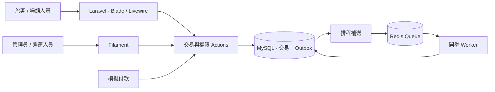

# TravelOps

TravelOps 是獨立開發的旅遊電子票券履約與營運平台作品。V3 改善旅客購票、門市結帳與營運查核介面，沿用共用庫存、多供應商開券、非同步退款、交易對帳、通知及報表。場館、帳號和交易均使用合成資料。

公開 Demo 的獨立 PHP-FPM／Nginx／HTTPS、MySQL、Redis、Queue 與 Scheduler 配置見[部署說明](docs/deployment/DEMO_DEPLOYMENT.md)及[維運手冊](docs/deployment/DEMO_OPERATIONS.md)。目前尚未取得可用雲端 VM，不能視為已公開上線。

## 本地啟動

環境需有 Docker Engine（Windows 可使用 Docker Desktop 的 Linux containers）及 Docker Compose v2.24 以上。以下指令可在 PowerShell 或一般 shell 執行，PHP、Composer、Node、MySQL 與 Redis 由容器提供。

```sh
docker compose up --build -d --wait
docker compose exec app php artisan travelops:demo --reconciliation-fixture
```

開啟 [票券目錄](http://localhost:8080/products)、[門市 POS](http://localhost:8080/pos)、[場館核銷](http://localhost:8080/merchant/redemptions) 或 [Filament 營運台](http://localhost:8080/ops)。第一次啟動會遷移並建立示意商品，第二行會產生 Demo 帳密與交易範例。初始化服務將應用程式金鑰與 Webhook HMAC 密鑰保存在本地 volume。Web 只綁定 loopback。MySQL 與 Redis 只開放給 Compose 網路。

遺失 Demo 密碼時執行 `docker compose exec app php artisan travelops:demo --reset-passwords`。門市人員從 `/pos` 進入授權門市。操作流程見 [V2 展示指南](docs/demo/V2_DEMO_GUIDE.md)。

MySQL 首次建立 Volume 時會執行 `docker/mysql/20-test-db.sql`。啟動前確認來源是檔案。PowerShell 可執行 `Test-Path -LiteralPath docker/mysql/20-test-db.sql -PathType Leaf`。若舊工作樹同名路徑是目錄，先檢查內容與 Git 狀態，保留原目錄後再使用 V3 檔案。已有 Volume 時，若查證缺少測試 schema 或權限，依 [舊 Volume 修補紀錄](docs/reports/V3_UX_DOCKER_VALIDATION.md#既有-volume) 只補上測試 schema 與授權。

| 示範 | 操作 |
|---|---|
| 重複或亂序付款回呼 | 訂單頁選擇同名模擬付款情境 |
| 首次開券逾時 | 購買港城設計館單館票並模擬付款成功 |
| 永久失敗與人工補償 | 購買岬角觀景台單館票。在供應商頁切換情境為正常，再從開券異常頁重新排程 |
| 部分核銷禁止整筆退款 | 使用聯票其中一個場館後申請退款，由營運審核 |

## 品質檢查

```sh
docker compose config --quiet
docker compose exec -T app php vendor/bin/pint --test
docker compose exec -T app php vendor/bin/phpstan analyse --no-progress --memory-limit=1G
docker compose exec -T app php vendor/bin/phpunit
```

前端由 Dockerfile 執行 `npm ci` 與 `npm run build`。測試限用本地 MySQL 的 `travelops_test` 與專用 Redis 前綴，包含測試資料清理。日常 Demo 資料在 `travelops_demo`。停止服務用 `docker compose down`，資料會保留。

## 瀏覽器煙霧測試

另外準備 Node 24 及 Chrome，可在乾淨的專用 Demo DB 重跑瀏覽器旅程。先將 `travelops:demo --reset-passwords --reconciliation-fixture` 的輸出存到未追蹤的 `.runtime/demo-credentials.txt`，再執行 `npm ci` 和 `npm run smoke:browser`。可用 `TRAVELOPS_URL` 指定 Demo 網址，或用 `TRAVELOPS_DEMO_CREDENTIALS` 指定本機帳密檔。

## 架構

PHP 8.4、Laravel 13、Blade、Livewire 4、Tailwind CSS 4、Filament 5、MySQL 8.4/InnoDB、Redis 7.4。版本由 Composer 與 npm lockfiles 解析。



線上與門市共用 MySQL 庫存鎖與預留邏輯。簽章回呼、冪等鍵和 Outbox 保護交易重送與非同步處理。門市、場館和營運操作依角色與指派範圍授權，關鍵狀態轉換保留稽核紀錄。

架構與邊界見 [V2 系統總覽](docs/architecture/V2_SYSTEM_OVERVIEW.md)、[V2 資料模型](docs/architecture/V2_DATA_MODEL.md) 及 [報表定義](docs/architecture/REPORTING_DEFINITIONS.md)。工程取捨見 [作品案例](docs/portfolio/TRAVELOPS_CASE_STUDY.md)。GitHub Actions 在 Linux Compose 執行 PHP 格式、靜態分析、PHPUnit 和 Chrome 旅程。環境差異與測試證據見 [V3 UX 與 Docker 驗收](docs/reports/V3_UX_DOCKER_VALIDATION.md)。

## 展示限制

付款、退款、供應商與外部通知均為模擬。核銷可輸入文字代碼或貼上 QR 掃描結果。實機掃碼及壓力測試尚未驗證。Mock webhook 僅在本地或測試環境且有獨立密鑰時啟用。Compose 憑證僅供本地 Demo，`.env`、資料目錄、執行期密鑰及 Demo 帳密都不應加入版控。
