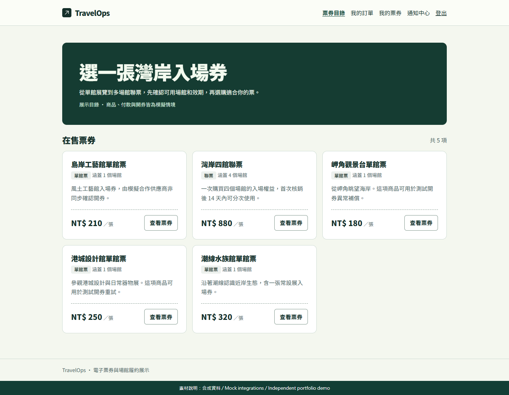
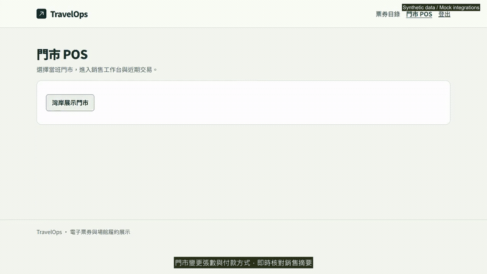
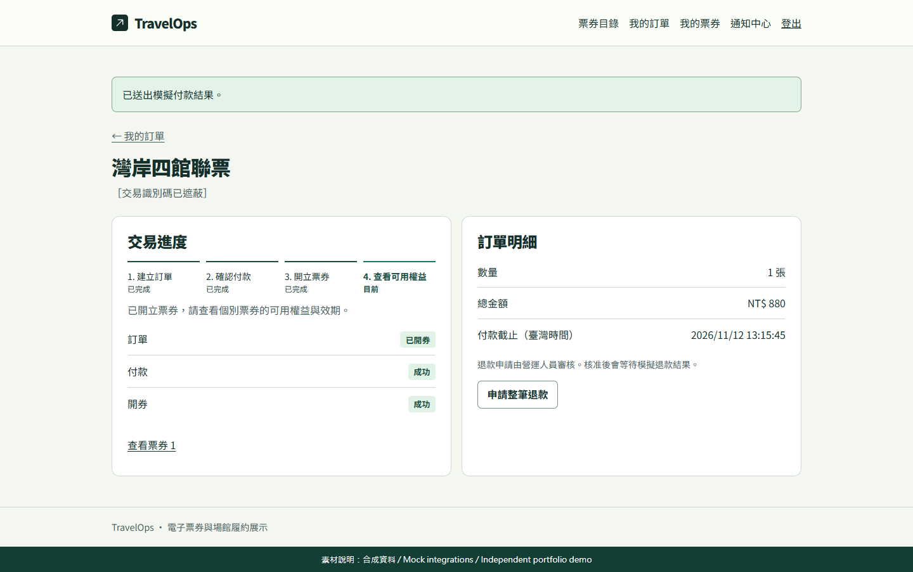
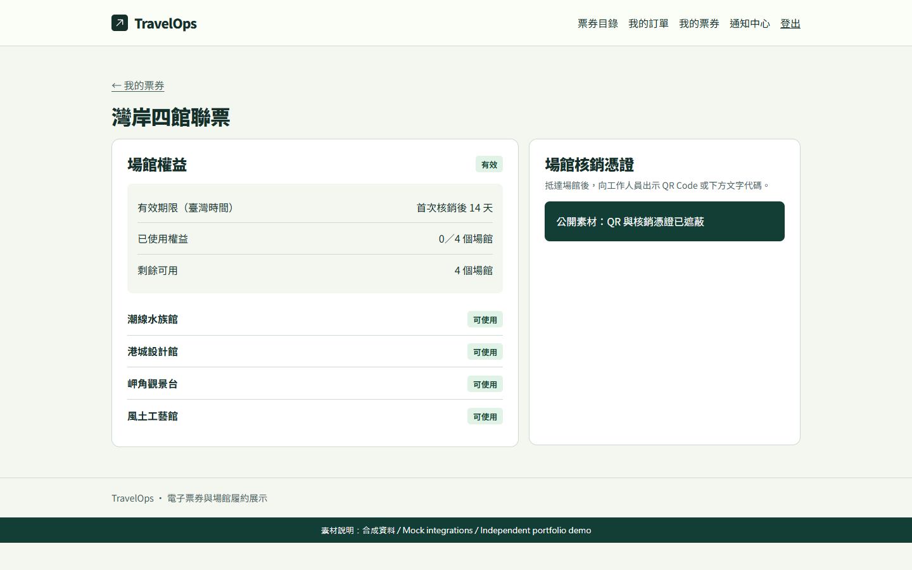
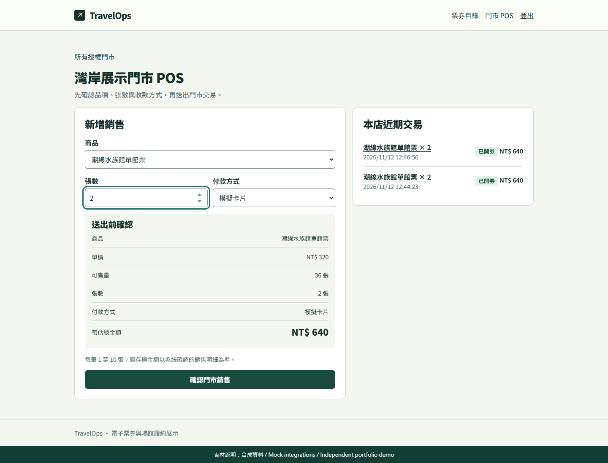
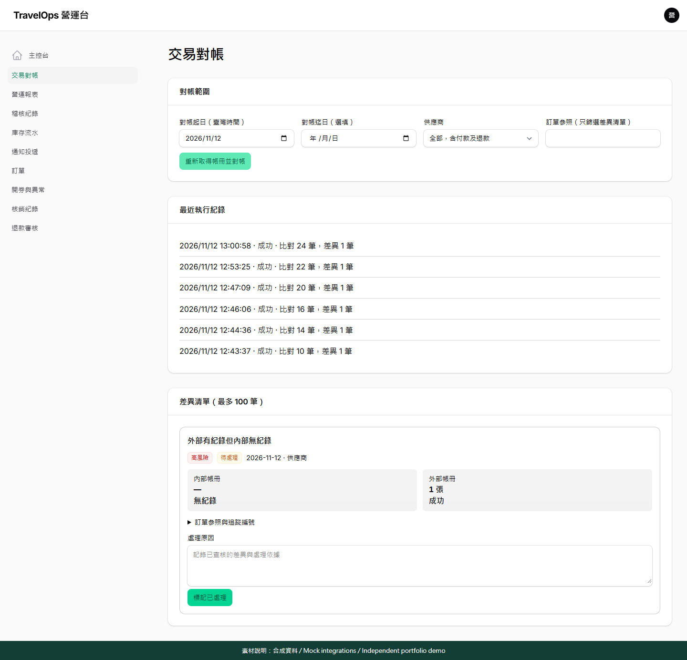
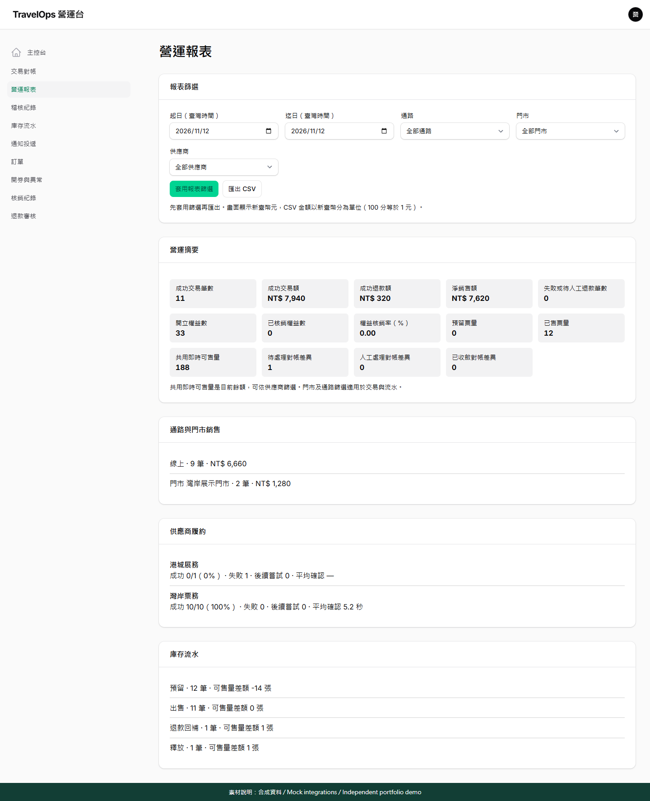
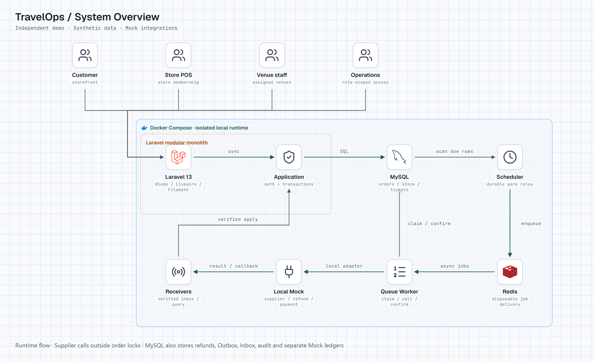

# TravelOps

串接旅客購票、門市 POS、場館核銷與營運對帳，以共用庫存與可復原的非同步開券處理重複回呼、供應商逾時及退款競爭。

[English](README.en.md) · [繁中完整案例](docs/portfolio/travelops-v3/TRAVELOPS_PORTFOLIO_ZH_TW.md) · [English case study](docs/portfolio/travelops-v3/TRAVELOPS_PORTFOLIO_EN.md)



這是可在本機執行的工程展示作品。場館、帳號與交易使用合成資料；付款、退款、供應商及外部通知為本地 Mock。以下直接提供真實操作素材，不需先安裝環境。

## Demo / 操作展示

[觀看／下載 74 秒 Demo（MP4，約 1 MB）](docs/portfolio/travelops-v3/video/travelops-v3-demo.mp4)：旅客購票與重複付款回呼 → 開券與場館權益 → 門市銷售 → 開券異常、對帳與報表。影片含繁中字幕，另附 [English SRT](docs/portfolio/travelops-v3/video/travelops-v3-demo.en.srt)；GitHub 若未提供內嵌播放，可下載檔案觀看。

下方 16 秒 GIF 擷取同一支真實錄影的 POS 流程：選商品、調整張數與付款方式、確認 NT$ 640，再送出銷售。GIF 約 598 KiB，完整影片保留更多操作細節。



素材錄於 2026-11-12，完整交易識別碼與核銷憑證已遮蔽；[分鏡與剪接說明](docs/portfolio/travelops-v3/video/demo-storyboard.md)記錄來源。現有影片已納入 Repository，沒有新增外部影片託管或公開服務。

## 解決的問題與核心功能

線上與門市需要共用同一份庫存。付款回呼可能重送，供應商可能已開券卻沒有回應，退款審核也可能與現場核銷同時發生。TravelOps 把這些狀態交由 MySQL 交易與明確的業務規則協調，再以排程及 Queue 執行可重試工作，讓營運人員能追查未完成交易。

### 購票與開券進度

訂單把付款、開券與可用權益分開顯示，方便旅客辨認已付款但仍待開券的狀態。付款模擬器可重現重複及亂序回呼。



### 場館權益與核銷

聯票逐一記錄各場館的剩餘權益，首次成功核銷後開始計算效期。場館人員只能操作指派場館；退款處理中的票券暫停核銷。畫面中的 QR 與代碼已遮蔽。



### 門市 POS 與共用庫存

店員確認商品、張數、收款方式與摘要後送出，後端與線上購票共用計價、庫存預留及冪等檢查。主管另可查看臺灣營業日的日結摘要。



### 退款與交易對帳

營運人員審核整筆退款、追查開券及取消結果，再比對內部交易與獨立保存的 Mock 帳冊。差異處置保留原因，不覆寫原交易金額。



### 報表與營運查核

依日期、通路、門市及供應商查詢，並匯出 CSV。介面顯示新臺幣元，CSV 使用整數分；圖中 KPI 是合成交易結果。



另有 [390 px 手機商品頁](docs/portfolio/travelops-v3/screenshots/travelops-product-mobile.png)及[手機 POS](docs/portfolio/travelops-v3/screenshots/travelops-pos-mobile.png)。全部 8 張原始截圖的路由、尺寸與來源見[截圖清單](docs/portfolio/travelops-v3/screenshots-manifest.md)。

## Architecture / 系統架構



這是一個模組化單體：Blade、Livewire 與 Filament 共用 Laravel Application services，MySQL 是訂單、庫存及交易狀態的依據。Scheduler 掃描 MySQL 的持久工作列，再送入 Redis Queue；Worker 以租約、狀態查詢及確認交易處理本地 Mock。資料庫不會主動推送工作，圖中的箭頭代表排程讀取。

本輪以 graphify 程式結構抽取及原始碼交叉核對既有圖；逐項來源見[本輪架構與展示驗證](docs/portfolio/travelops-v3/SHOWCASE_VALIDATION.md)。可放大閱讀[總覽 SVG](docs/portfolio/travelops-v3/architecture/travelops-system-overview.svg)、[交易流程 SVG](docs/portfolio/travelops-v3/architecture/travelops-transaction-flow.svg)與[Mermaid 來源](docs/portfolio/travelops-v3/architecture/travelops-system-overview.mmd)。

## Engineering Highlights / 技術決策

| 問題 | 實作與取捨 | 可追查來源 |
| --- | --- | --- |
| 兩個通路同時售票 | POS 重用 `Checkout::place`，在交易中鎖定商品與庫存、建立權益快照及預留。尚未量測正式負載下的吞吐量。 | [Checkout](app/Application/Checkout.php)、[併發測試](tests/Integration/MySqlConcurrencyTest.php) |
| 回呼重送或內容衝突 | 驗證 HMAC、付款參考、金額與幣別；event key 和 body hash 區分相同重送與衝突內容。 | [PaymentWebhook](app/Application/PaymentWebhook.php) |
| 付款成功但工作未送達 | 付款與開券 Outbox 同交易提交；排程補送、穩定請求 key、租約及先查詢再重送，讓工作可恢復。供應商呼叫在訂單鎖外，結果另開交易確認。 | [Issuance](app/Application/Issuance.php)、[Outbox 測試](tests/Integration/RedisOutboxTest.php) |
| 退款與核銷競爭 | 兩者共用訂單鎖；核准且未確認的退款暫停核銷，退款確認後才撤銷權益與回補庫存。只支援整筆退款。 | [RefundOrder](app/Application/RefundOrder.php)、[Redeem](app/Application/Redeem.php) |
| 查核需要保留原始證據 | 原交易、Mock 帳冊及人工處置分開保存；對帳可重跑，差異處置不改寫交易。 | [Reconcile](app/Application/Reconcile.php)、[報表定義](docs/architecture/REPORTING_DEFINITIONS.md) |

POS 的付款 adapter 是本地 Mock，刻意放在外層交易內；不能直接套用為真實網路金流設計。供應商及退款回呼有時間窗驗證，付款回呼則沒有相同時間窗。完整取捨保留於 [ADR 004](docs/decisions/004-v2-operation-reliability.md)、[V2 系統總覽](docs/architecture/V2_SYSTEM_OVERVIEW.md)、[資料模型](docs/architecture/V2_DATA_MODEL.md)與[作品案例](docs/portfolio/TRAVELOPS_CASE_STUDY.md)。

## Testing & Results / 測試與成果

| 證據 | 已確認結果 | 範圍 |
| --- | --- | --- |
| [2026-11-12 媒體驗收](docs/portfolio/travelops-v3/MEDIA_VALIDATION_REPORT.md) | 34 PHPUnit tests、416 assertions、0 failures | 當次隔離 MySQL／Redis 環境；包含併發、Outbox、角色與退款邊界，屬歷史執行紀錄。 |
| [基準分支 CI](https://github.com/Cizing24/TravelOps/actions/runs/44552435274) | 36 PHPUnit tests、425 assertions；`9bf8b97` 的 TravelOps CI 成功 | 2026-11-19 的 Linux Compose、Pint、PHPStan、PHPUnit 與 Chrome 旅程；本輪已查核遠端結果與 log。 |
| [V3 UX 與 Docker 驗收](docs/reports/V3_UX_DOCKER_VALIDATION.md) | 桌面 1280 px、平板 768 px、手機 390 px 的頁面溢出與主要畫面檢查 | Chrome；不等於手機實機、讀屏或所有瀏覽器驗證。 |
| [本輪展示驗證](docs/portfolio/travelops-v3/SHOWCASE_VALIDATION.md) | README 連結、PNG／SVG、GIF 動態影格、74 秒 MP4 解碼與來源核對 | 文件及媒體檢查；本輪未在本機重跑完整業務測試。 |

沒有正式環境流量、商業成效或效能提升百分比。最新 PR 的執行結果請以 PR Checks 為準。

## Tech Stack / 技術組成

PHP 8.4、Laravel 13、Blade、Livewire 4、Filament 5、Tailwind CSS 4、MySQL 8.4/InnoDB、Redis 7.4、Docker Compose；PHPUnit 與 Playwright 驗證業務及瀏覽器旅程。實際套件版本以 [composer.lock](composer.lock) 與 [package-lock.json](package-lock.json) 為準。

## Getting Started / 本地啟動

環境需有 Docker Engine（Windows 可使用 Docker Desktop 的 Linux containers）及 Docker Compose v2.24 以上。以下指令可在 PowerShell 或一般 shell 執行，PHP、Composer、Node、MySQL 與 Redis 由容器提供。

```sh
docker compose up --build -d --wait
docker compose exec app php artisan travelops:demo --reconciliation-fixture
```

開啟 [票券目錄](http://localhost:8080/products)、[門市 POS](http://localhost:8080/pos)、[場館核銷](http://localhost:8080/merchant/redemptions) 或 [Filament 營運台](http://localhost:8080/ops)。第一次啟動會遷移並建立示意商品，第二行會產生 Demo 帳密與交易範例。初始化服務將應用程式金鑰與 Webhook HMAC 密鑰保存在本地 volume。Web 只綁定 loopback。MySQL 與 Redis 只開放給 Compose 網路。

遺失 Demo 密碼時執行 `docker compose exec app php artisan travelops:demo --reset-passwords`。門市人員從 `/pos` 進入授權門市。操作流程見 [V2 展示指南](docs/demo/V2_DEMO_GUIDE.md)。

MySQL 首次建立 Volume 時會執行 `docker/mysql/20-test-db.sql`。啟動前確認來源是檔案。PowerShell 可執行 `Test-Path -LiteralPath docker/mysql/20-test-db.sql -PathType Leaf`。若舊工作樹同名路徑是目錄，先檢查內容與 Git 狀態，保留原目錄後再使用 V3 檔案。已有 Volume 時，若查證缺少測試 schema 或權限，依 [舊 Volume 修補紀錄](docs/reports/V3_UX_DOCKER_VALIDATION.md#既有-volume) 只補上測試 schema 與授權。

| 示範 | 操作 |
|---|---|
| 重複或亂序付款回呼 | 訂單頁選擇同名模擬付款情境 |
| 首次開券逾時 | 購買港城設計館單館票並模擬付款成功 |
| 永久失敗與人工補償 | 購買岬角觀景台單館票。在供應商頁切換情境為正常，再從開券異常頁重新排程 |
| 部分核銷禁止整筆退款 | 使用聯票其中一個場館後申請退款，由營運審核 |

## 品質檢查

```sh
docker compose config --quiet
docker compose exec -T app php vendor/bin/pint --test
docker compose exec -T app php vendor/bin/phpstan analyse --no-progress --memory-limit=1G
docker compose exec -T app php vendor/bin/phpunit
```

前端由 Dockerfile 執行 `npm ci` 與 `npm run build`。測試限用本地 MySQL 的 `travelops_test` 與專用 Redis 前綴，包含測試資料清理。日常 Demo 資料在 `travelops_demo`。停止服務用 `docker compose down`，資料會保留。

## 瀏覽器煙霧測試

另外準備 Node 24 及 Chrome，可在乾淨的專用 Demo DB 重跑瀏覽器旅程。先將 `travelops:demo --reset-passwords --reconciliation-fixture` 的輸出存到未追蹤的 `.runtime/demo-credentials.txt`，再執行 `npm ci` 和 `npm run smoke:browser`。可用 `TRAVELOPS_URL` 指定 Demo 網址，或用 `TRAVELOPS_DEMO_CREDENTIALS` 指定本機帳密檔。

## Project Status / 展示限制

付款、退款、供應商與外部通知均為模擬。核銷可輸入文字代碼或貼上 QR 掃描結果。實機掃碼及壓力測試尚未驗證。Mock webhook 僅在本地或測試環境且有獨立密鑰時啟用。Compose 憑證僅供本地 Demo，`.env`、資料目錄、執行期密鑰及 Demo 帳密都不應加入版控。

已實作購票、POS、庫存、開券、核銷、整筆退款、對帳、通知及報表；尚未串接真實金流、供應商或外部通知，也未驗證正式負載。公開 Demo 的獨立 PHP-FPM／Nginx／HTTPS、MySQL、Redis、Queue 與 Scheduler 配置見[部署說明](docs/deployment/DEMO_DEPLOYMENT.md)及[維運手冊](docs/deployment/DEMO_OPERATIONS.md)。目前尚未取得可用雲端 VM，不能視為已公開上線；本輪只整理文件與既有真實媒體。
