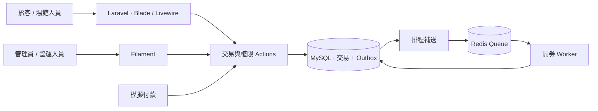

# TravelOps

TravelOps 是獨立原創的旅遊電子票券履約與營運管理系統，用於展示庫存預留、模擬付款、異步開券、四館聯票核銷與退款。這是求職展示專案，與太金國際旅行社有限公司無關，非其官方產品。所有場館、帳號及交易均為示意。

## 本地啟動

環境需有 Docker Engine（Windows 可使用 Docker Desktop 的 Linux containers）及 Docker Compose v2.24 以上。以下指令可在 PowerShell 或一般 shell 執行，PHP、Composer、Node、MySQL 與 Redis 由容器提供。

```sh
docker compose up --build -d --wait
docker compose exec app php artisan travelops:demo
```

開啟 [票券目錄](http://localhost:8080/products)、[場館核銷](http://localhost:8080/merchant/redemptions) 或 [Filament 營運台](http://localhost:8080/ops)。第一次啟動會遷移並建立示意商品，第二行會產生 Demo 帳密與交易範例。初始化服務將應用程式金鑰與 Webhook HMAC 密鑰保存在本地 volume。Web 只綁定 loopback。MySQL 與 Redis 只開放給 Compose 網路。

遺失 Demo 密碼時執行 `docker compose exec app php artisan travelops:demo --reset-passwords`。帳號按旅客、管理員、營運與個別場館人員分開。操作流程見 [Demo 指引](docs/demo/DEMO_GUIDE.md)。

| 示範 | 操作 |
|---|---|
| 重複或亂序付款回呼 | 訂單頁選擇同名模擬付款情境 |
| 首次開券逾時 | 購買港城設計館單館票並模擬付款成功 |
| 永久失敗與人工補償 | 購買岬角觀景台單館票。在供應商頁切換情境為正常，再從開券異常頁重新排程 |
| 部分核銷禁止整筆退款 | 使用聯票其中一個場館後申請退款，由營運審核 |

## 品質檢查

```sh
docker compose config --quiet
docker compose exec -T app php vendor/bin/pint --test
docker compose exec -T app php vendor/bin/phpstan analyse --no-progress --memory-limit=1G
docker compose exec -T app php vendor/bin/phpunit
```

前端由 Dockerfile 執行 `npm ci` 與 `npm run build`。測試限用本地 MySQL 的 `travelops_test` 與專用 Redis 前綴，包含資料庫清理。日常 Demo 資料在 `travelops_demo`。停止服務用 `docker compose down`，資料會保留。資料重置方式見 Demo 指引。

## 瀏覽器煙霧測試

另外準備 Node 24 及 Chrome，可在專用 Demo DB 重跑瀏覽器旅程。先將 `travelops:demo --reset-passwords` 的輸出存到未追蹤的 `.runtime/demo-credentials.txt`，再執行 `npm ci` 和 `npm run smoke:browser`。可用 `TRAVELOPS_URL` 指定 Demo 網址，或用 `TRAVELOPS_DEMO_CREDENTIALS` 指定本機帳密檔。測試會建立示意訂單、核銷與退款。

## 架構

PHP 8.4、Laravel 13、Blade、Livewire 4、Tailwind CSS 4、Filament 5、MySQL 8.4/InnoDB、Redis 7.4。版本由 Composer 與 npm lockfiles 解析。



架構與邊界見 [系統總覽](docs/architecture/SYSTEM_OVERVIEW.md)、[ERD](docs/architecture/DATA_MODEL.md) 與 [API](docs/api/API_REFERENCE.md)。本次結果見 [MVP 成果報告](docs/reports/MVP_DELIVERY_REPORT.md)。

## 展示限制

付款、退款與供應商均為模擬。核銷可使用文字代碼，支援將 QR 掃描結果貼入輸入欄。Mock webhook 僅在本地或測試環境且有獨立密鑰時啟用。Compose 憑證僅供本地 Demo，`.env`、資料目錄、執行期密鑰及 Demo 帳密都不應加入版控。
