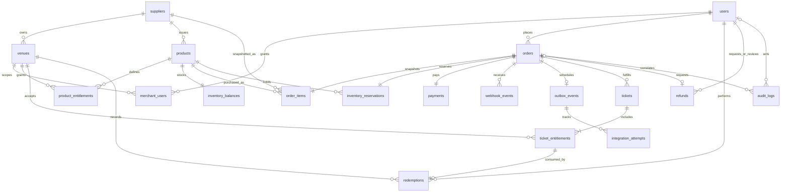

# TravelOps 資料模型

| 唯一鍵 | 用途 |
|---|---|
| `orders(user_id, idempotency_key)` | 相同旅客與下單意圖只建一單 |
| `webhook_events(provider, external_event_id)` | 辨識重送，並核對原始 payload 雜湊 |
| `payments(order_id)`、`payments(idempotency_key)` | 單筆付款聚合及付款參考 |
| `inventory_balances(product_id)`、`inventory_reservations(order_id)` | 庫存原子調整及單一預留 |
| `outbox_events(order_id)`、`integration_attempts(outbox_event_id, number)` | 單一開券意圖與完整嘗試序列 |
| `tickets(order_id, sequence)`、`tickets(code_hash)` | 每件商品一張票，憑證可快速查找 |
| `ticket_entitlements(ticket_id, venue_id)`、`redemptions(ticket_entitlement_id)` | 場館權益只成功消耗一次 |
| `refunds(order_id)`、`refunds(idempotency_key)` | 全額退款只處理一次 |

金額為整數新臺幣分。時間欄位按 UTC 寫入，UI 按 Asia/Taipei 呈現。訂單明細保存商品名稱、單價、數量、供應商、效期及場館 ID／名稱快照。QR 代碼以 AES 加密保存，查找使用 SHA-256 雜湊。稽核提供操作者、關聯訂單、追蹤編號及時間，營運介面只有查閱功能。
