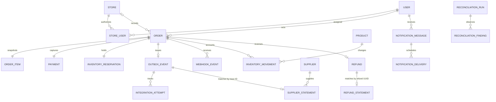

# TravelOps V2 data model

The V2 migrations extend the existing MySQL database. Existing orders default
to the online channel and use the original mock payment method. Existing
suppliers default to synchronous delivery. The inventory ledger starts at the
V2 migration boundary. Opening balances and historical reservations remain in
`inventory_balances` and `inventory_reservations`.

Issuance claims the outbox event with a two-minute lease, calls the provider
outside the transaction, then applies the result if the lease token still
matches. The UUID trace is also the provider request key. A successful callback
can settle before the originating worker writes back. Both paths lock the order
and outbox row and share the same ticket creation code.

Online and POS checkout lock the same product and inventory balance. A POS
order records the authenticated cashier as its actor. A store-scoped unique key
prevents replay from another cashier at that store. POS checkout and local mock
capture commit together. There is one sale per reservation and sale has a
zero available-stock delta because the reservation already reduced availability.

Stock movement uniqueness is scoped to order and movement kind. Adjustments
have an operator and reason and update the same authoritative balance. Order
reads and ticket links in the POS flow require active store membership.

Refund approval is serialized by the order lock and persisted in the refund
row. Processing claims a timed lease using the attempt number as a fence.
Callback Inbox keys are unique by event type and UUID. Once the provider
confirms, a single transaction applies refund, ticket revocation, stock
movement and notifications. An existing `processed` refund does not enter
the worker's ready set.

Reconciliation stores each run separately and upserts observations by a
SHA-256 fingerprint. Notification messages have a unique recipient,
template and event tuple. Each message has at most one delivery row per
simulated external channel. The in-app message is the in-app delivery.
