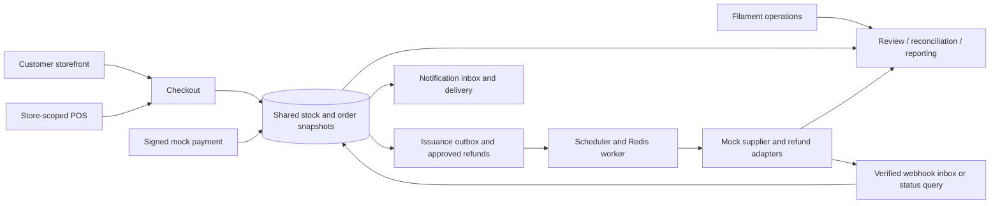

# TravelOps V2 system overview

TravelOps runs as a Laravel application with Blade, Livewire and Filament.
MySQL/InnoDB owns transaction state. Redis carries disposable jobs and cache
locks. The scheduler rebuilds delivery from durable database rows.

Customer access is order-owner scoped. POS clerks and supervisors require
store membership, and only supervisors can request POS refunds or close the
day. Merchants redeem only at assigned venues. Operators review refunds and
operate reconciliation, delivery monitoring and reports. Admins maintain
suppliers, stores, role assignments and inventory adjustments.

The scheduler relays issuance, refunds and simulated notifications every ten
seconds. It releases expired holds every minute and checks ticket reminders
hourly. Daily reconciliation runs at 02:00 Taiwan time for the previous
business date. Manual reconciliation uses the same comparison as the schedule.

The order lock serializes issuance confirmation, refund approval and ticket
redemption. Supplier and refund submissions use durable UUIDs, and adapter
calls run outside the order transaction. Signed callbacks use domain-specific
HMAC input, a timestamp window and a unique event key. The mock statements
persist separately from application completion and let a retry recover
when the worker misses a reply.

All external integrations use synthetic local data. Webhook test routes are
enabled only in testing. The local queue exercises the same verified
receiver without exposing a public callback route.
